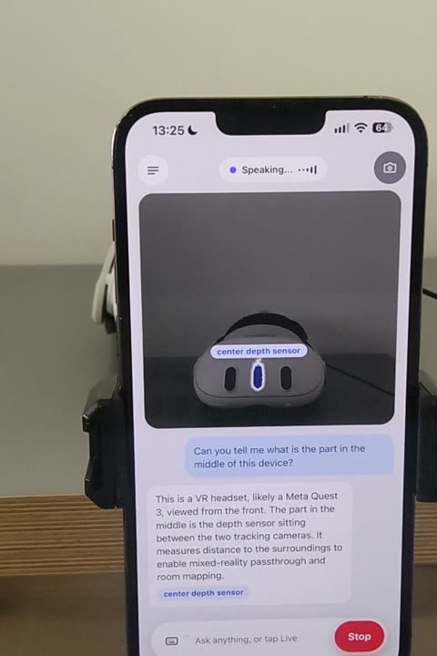
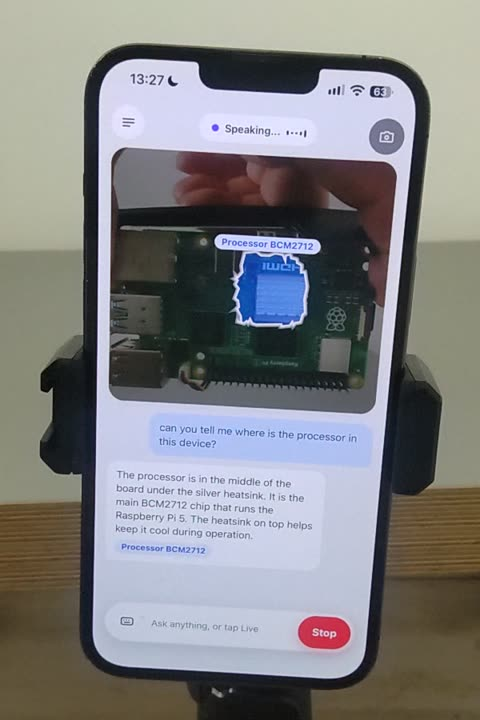
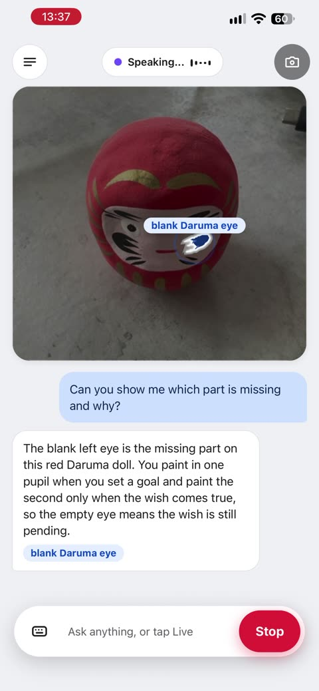
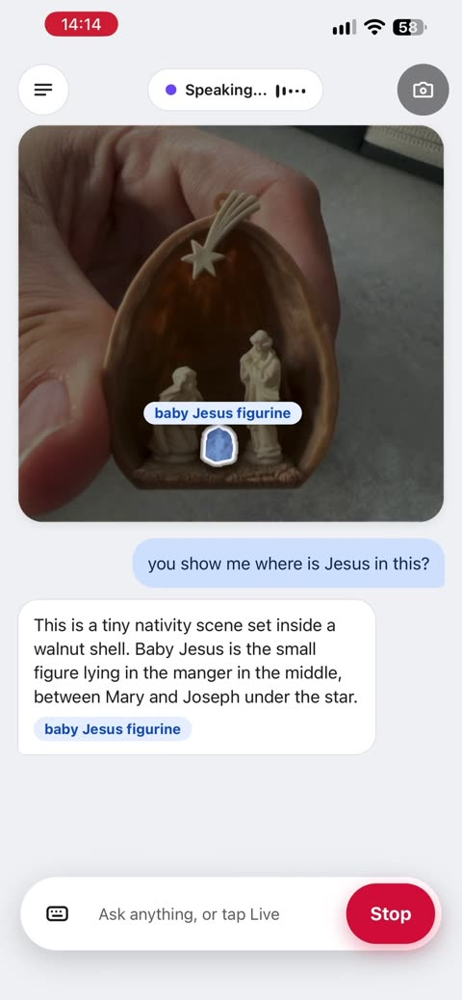

# Show It To Me

**Point your phone at anything. Ask out loud. It shows you.**

Show It To Me is a camera guide you talk to. Point your phone at a Meta Quest 3, a circuit board or a Daruma doll and ask, "What is the part in the middle of this device?" In about five seconds the app draws that exact part on your picture and tells you what it is, out loud. There is nothing to install, no labels to print and no list of parts to set up. It works on things it has never seen. And it never bluffs: if it cannot point at the thing, it does not answer.

Built for the Meta Global AI Developer Hackathon, Indie Developer Track, on Meta's models: Muse Spark, SAM 3.1 and Muse Voice Transcribe.

**Watch the demo (1:41): https://youtu.be/xAUPXCmicME**

[](https://youtu.be/xAUPXCmicME)

<p>




</p>

*Real screens from a phone, left to right: a Quest 3, a Raspberry Pi 5, a Daruma doll, a nativity scene in a walnut shell.*

## What you get

* **Talk, don't type.** Tap Live once. The app shows "Getting ready", turns green, says "Hi, what do you want to know?" and listens. Typing works too.
* **An answer you can see.** Every answer comes with the part drawn on your photo: a glowing outline and a short label. If the app cannot mark it, it says so instead of guessing.
* **Fast.** One photo answer takes about five seconds end to end on the hosted models (median 5.0 s, 90th percentile 7.5 s over 35 live answers).
* **Any language.** The model is told to answer in the language of the question.
* **Any object.** It uses open vocabulary, so there is no fixed list of things it knows. For the Raspberry Pi 5 it also carries a small reference pack so parts get their exact names.
* **Your phone, your browser.** A web page. Add it to the home screen to get an app icon.

## How it works

1. The page captures a frame the moment you start speaking, and sends your spoken question to **Muse Voice Transcribe**.
2. **Muse Spark 1.3** reads the photo and the question. It returns a short answer, a label and a box for the part the answer is about. We run it at minimal reasoning effort and temperature 0, so an answer takes 2.1 to 3.1 s and the same photo gives boxes that overlap 0.79 to 1.0 between runs.
3. **SAM 3.1** turns that box into the exact outline of the part. If SAM cannot, the app draws Muse's box instead.
4. If there is still nothing to draw, the app does not give the answer. It asks you to move closer and try again.
5. The page draws the outline on your photo and speaks the answer.

While you frame the shot, the app quietly scans the scene so the answer is ready sooner (scan-ahead).

## Built on Meta models

| Model | Job |
|---|---|
| Muse Spark 1.3 (`muse-spark-1.3`, Meta Model API) | Reads the photo and the question, writes the answer, picks the part |
| SAM 3.1 (`sam-3.1`, Meta Model API) | Cuts the exact outline of the part out of the photo |
| Muse Voice Transcribe (`muse-voice-transcribe-1.0`, Meta Model API) | Turns the spoken question into text |
| Muse Spark Open (open weight, on Baseten) | The coding agent that wrote most of the app, and the photo answers for a day |
| Muse Glimmer 30B (open weight) | The first test bench: early measurements and answers, run on our own GPU |
| SAM 3 (open weight) | The local outline path, kept in the repo as a measuring bench and a fallback that needs no hosted key |

How we built it: we developed and measured on our own hardware first (local Muse Glimmer and SAM 3), then moved the live app to Meta's hosted Model API so serving needs no GPU. The app was written with Muse Spark Open and several other AI coding agents.

## Run it

You need Python 3.10 or newer and a Meta Model API key. Serving needs no GPU.

```bash
cd server
SAM_BACKEND=meta \
MUSE_API_BASE=https://api.meta.ai/v1 MUSE_MODEL=muse-spark-1.3 \
MUSE_API_KEY=... META_API_KEY=... \
MUSE_REASONING_EFFORT=minimal MUSE_TEMPERATURE=0 \
SIT_PORT=8896 python3 server.py
```

Serve `static/` from any web server and proxy `/api/` to the port above. The camera and microphone need HTTPS (or `localhost`).

Voice out: with no speech engine configured, the page speaks answers with the browser's own voice. To use your own text-to-speech engine, set `ENGINE_BASE` and `ENGINE_TOKEN`.

| Variable | What it does |
|---|---|
| `MUSE_API_BASE`, `MUSE_API_KEY`, `MUSE_MODEL` | Any OpenAI-compatible endpoint for the vision and language model (Meta Model API by default) |
| `META_API_KEY` | Muse Voice Transcribe and the hosted SAM 3.1 |
| `SAM_BACKEND` | `meta` (hosted SAM 3.1, no GPU) or `local` (SAM 3 on a GPU, needs `SAM3_CHECKPOINT`) |
| `MUSE_REASONING_EFFORT` | `minimal`, `low`, `medium` or `high`. `minimal` is fastest |
| `MUSE_TEMPERATURE`, `MUSE_SEED` | Set `0` for steady boxes between runs |
| `MUSE_HEDGE_S` | Seconds to wait before sending a second identical request and taking the first reply |
| `MUSE_MIN_TOKENS` | Room for reasoning before the JSON answer |
| `SIT_PORT` | HTTP port, default 8895 |
| `SIT_EVENT_LOG` | JSON-lines event log path, default `logs/events.jsonl` |
| `ENGINE_BASE`, `ENGINE_TOKEN` | Optional text-to-speech engine. Without them the browser voice is used |

Keys stay on the server. They are never sent to the browser, logged or committed.

## Tests

```bash
cd server && python3 -m unittest discover -s .   # 95 tests
node --check static/app.js
node tests/test_audio_fade.js && node tests/test_live_audio.js
```

`simulations/` holds Playwright checks that drive the page with a fake camera at phone sizes (390x844 and 320x568, Chrome and WebKit). They need `playwright-core`.

## Honest limits

* It works on photos. It does not check electrical connections or whether a board has booted.
* Meta's hosted calls sometimes stall. Most answers take about five seconds; in one live run a stall made a single answer take 43 seconds.
* The outline is only as good as SAM's cut: small parts in strong backlight can come out rough.
* The Raspberry Pi reference pack is optional. Other objects use the open vocabulary path.

## Photos in `fixtures/`

Test photos of a Raspberry Pi 5 and a few other objects come from Wikimedia Commons under CC BY or CC BY-SA. Authors and licenses are in `fixtures/pi5/provenance.json` and `fixtures/other/provenance.json`. The example screens above are our own.

## License

MIT, see `LICENSE`. `server/vendor/meta_sam_parser` is Meta's SAM parser and keeps its own license.
